# Manual de Uso – Cupcake Store

Este manual mostra, passo a passo, como usar a loja como **cliente** e como **administrador**.
Para testar sem cadastro, use os usuários de demonstração:

| Perfil | E-mail | Senha |
|---|---|---|
| Cliente | `cliente@cupcake.com` | `cliente12345` |
| Administrador | `admin@cupcake.com` | `admin12345` |

> Os pagamentos são simulados. Nenhum valor é cobrado.

---

## Parte 1 – Cliente

### 1. Ver o cardápio
Na página inicial aparecem todos os cupcakes disponíveis. Você pode:
- **buscar** pelo nome ou sabor no campo de busca;
- **filtrar** por categoria (Clássicos, Gourmet, Fit & Veganos, Datas Especiais);
- clicar no cupcake para ver os detalhes.

Não é preciso estar logado para ver o cardápio.

### 2. Criar uma conta
Clique em **Criar conta** e preencha nome, e-mail, CPF, telefone (opcional) e senha.
O sistema avisa quando algo está errado:
- CPF inválido;
- senha com menos de 8 caracteres;
- senha e confirmação diferentes;
- termos de uso não aceitos;
- e-mail ou CPF já cadastrado (o sistema oferece o login).

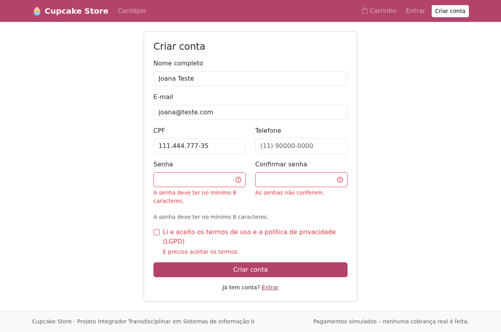

### 3. Adicionar ao carrinho
No cardápio, clique no botão de sacola do cupcake. Na página do produto, também dá para escolher a quantidade.
O sistema não deixa adicionar mais unidades do que há em estoque.

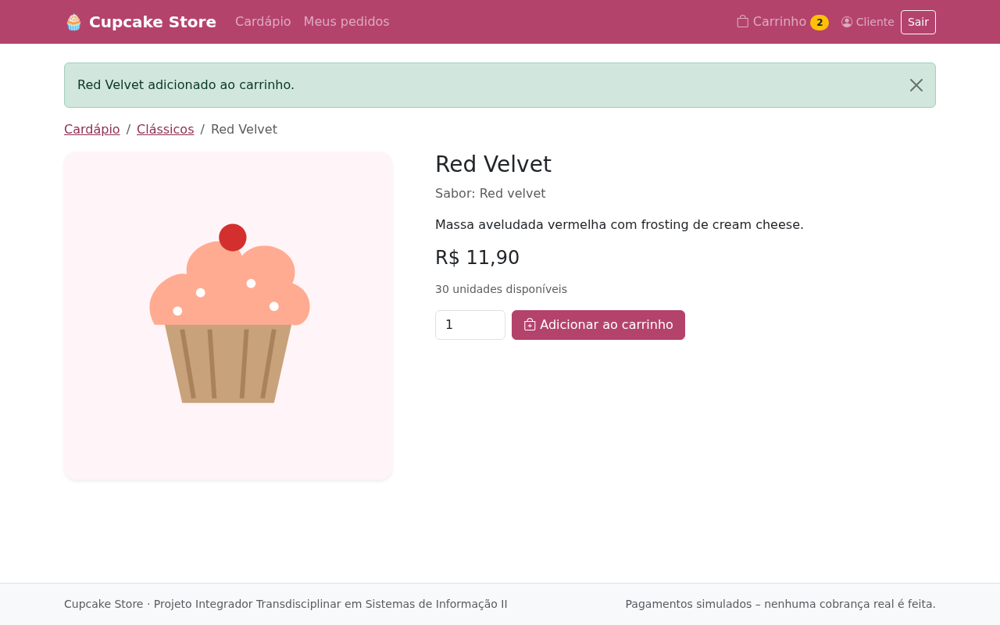

### 4. Revisar o carrinho
Clique em **Carrinho** no menu. Nele você pode:
- alterar a quantidade (o carrinho atualiza sozinho; o botão **Atualizar** também funciona);
- remover um item com 🗑️;
- clicar em **Finalizar compra**.

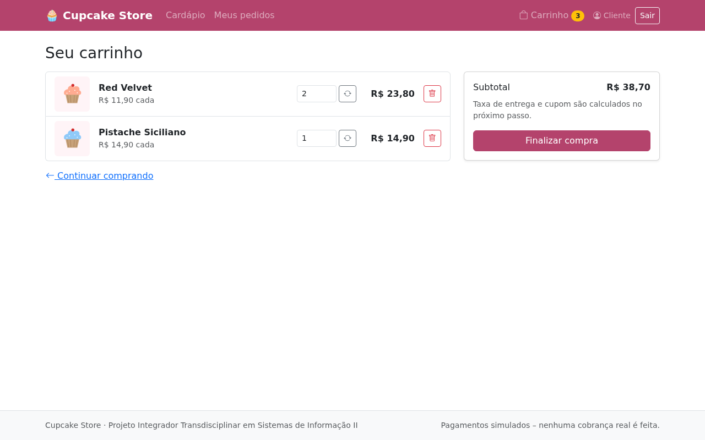

### 5. Finalizar a compra (checkout)
1. **Endereço:** escolha um endereço ou clique em **Novo endereço**. Ao digitar o CEP, rua, bairro e cidade são preenchidos automaticamente. Só entregamos para CEPs de 01000-000 a 09999-999 (Grande São Paulo): um CEP fora dessa faixa é recusado já no cadastro do endereço.
2. **Cupom:** digite o código (ex.: `BEMVINDO10` ou `DOCE20`) e clique em **Aplicar**. O desconto aparece no resumo.
3. **Pagamento:** escolha PIX, cartão de crédito ou cartão de débito.
4. Confira o resumo (subtotal, desconto, taxa de entrega e total) e clique em **Confirmar pedido**.

A taxa de entrega é de R$ 5,00 para CEPs de 01000-000 a 05999-999 e de R$ 9,90 para o restante da área atendida.

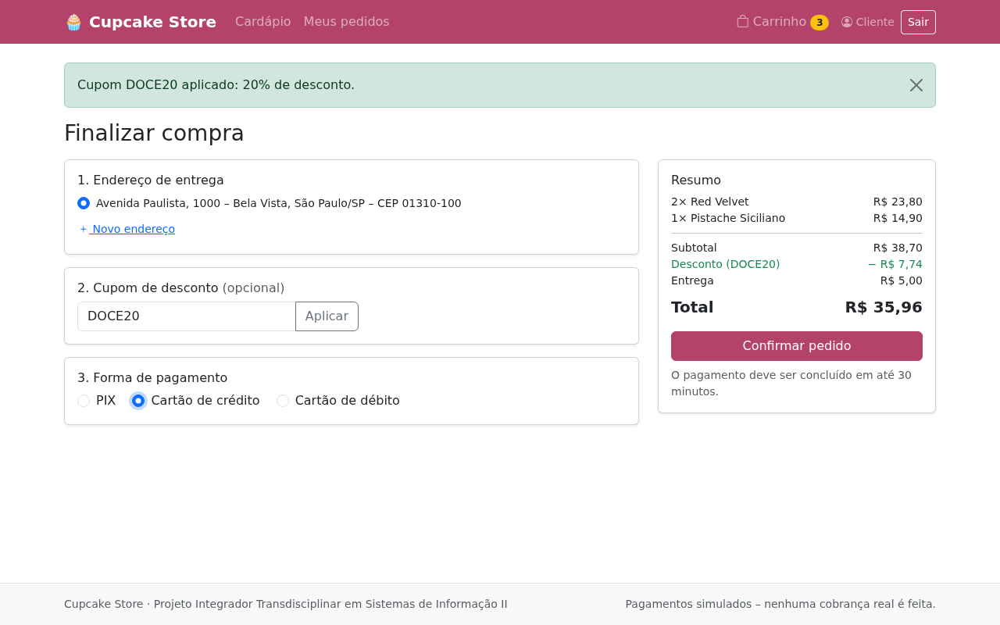

### 6. Pagar
**Com cartão:** preencha os dados e clique em **Pagar**. Cartões de teste:

| Resultado | Número do cartão | Validade | CVV |
|---|---|---|---|
| Aprovado | `4111 1111 1111 1111` | qualquer data futura | `123` |
| Recusado | `4000 0000 0000 0002` | qualquer data futura | `123` |

Se o pagamento for recusado, você pode tentar de novo ou trocar a forma de pagamento.
Depois de **3 recusas**, o pedido é cancelado.

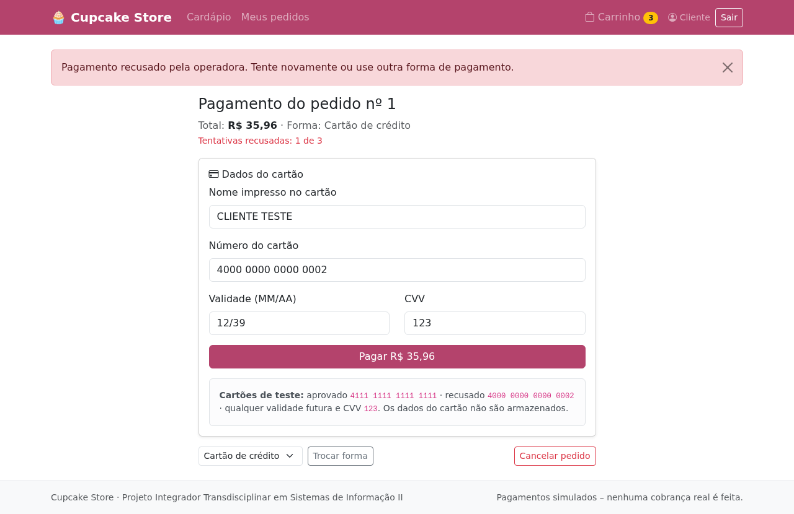

**Com PIX:** copie o código com o botão **Copiar** e clique em **Simular pagamento PIX**.
O pedido precisa ser pago em até **30 minutos**. Depois disso, é cancelado automaticamente.

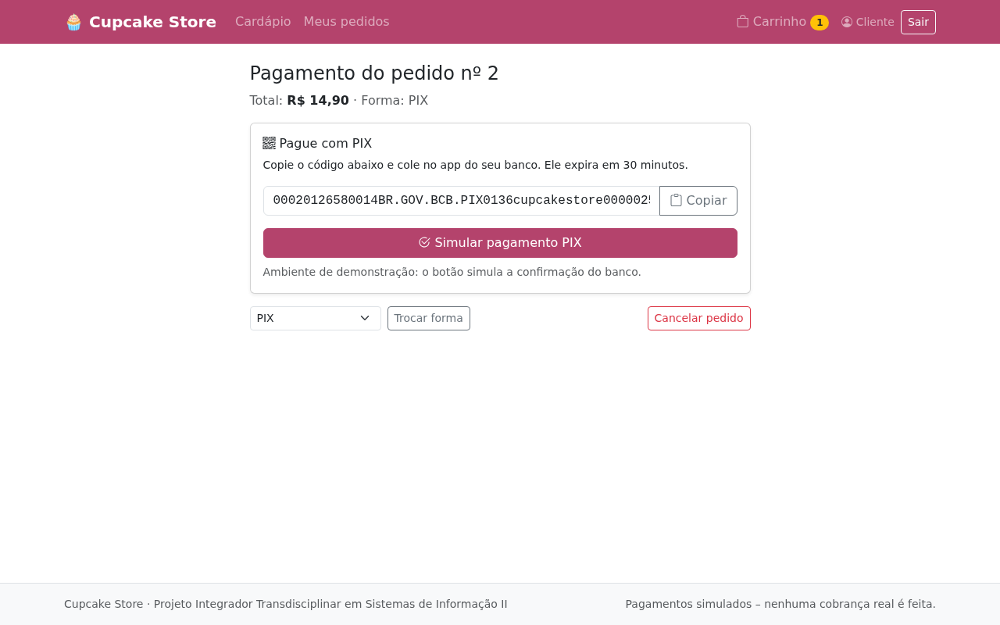

Com o pagamento aprovado, aparece a confirmação com o número do pedido e a previsão de entrega.

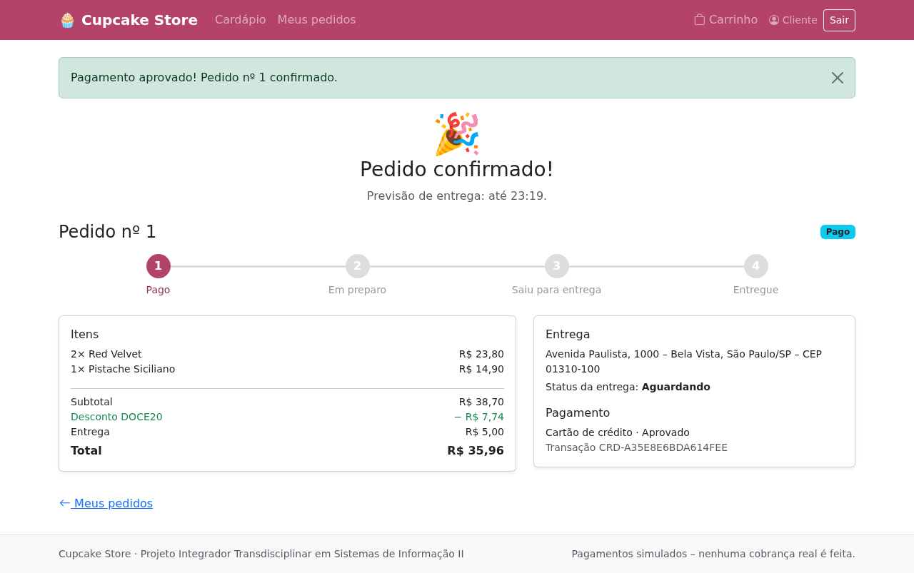

### 7. Acompanhar os pedidos
Em **Meus pedidos** ficam todos os seus pedidos com o status atual. Clique em um deles para ver:
- a linha do tempo (Pago → Em preparo → Saiu para entrega → Entregue);
- os itens e valores;
- o endereço, o entregador e os dados do pagamento.

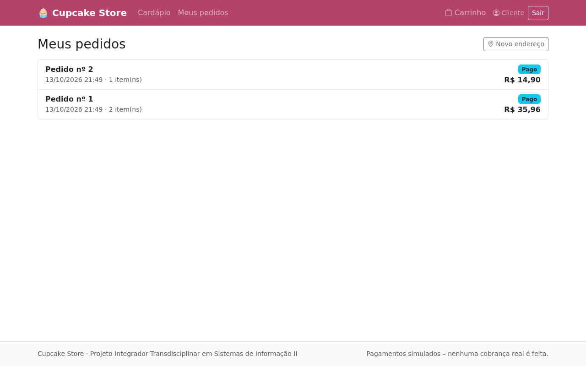

### 8. Avaliar
Quando o pedido estiver **Entregue**, aparece o formulário de avaliação: escolha de 1 a 5 estrelas e deixe um comentário.

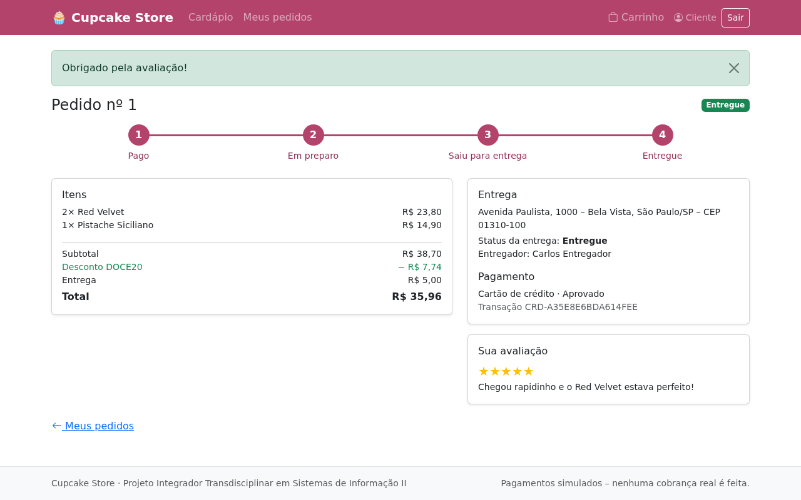

---

## Parte 2 – Administrador

Entre com `admin@cupcake.com` / `admin12345`. O menu passa a mostrar **Painel, Produtos, Pedidos e Relatório**.

### 1. Painel
Mostra os pedidos e o faturamento do dia, os pedidos em andamento, os últimos pedidos e os produtos com estoque baixo (menos de 5 unidades).

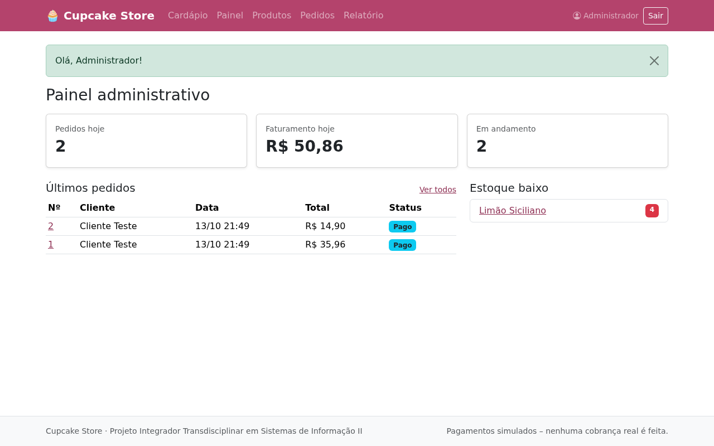

### 2. Gerenciar produtos
- **Novo produto:** preencha nome, categoria, sabor, preço, estoque, descrição e, se quiser, a URL de uma imagem JPG/PNG. Sem imagem, a loja mostra uma ilustração colorida.
- **Editar:** altera os dados de um produto.
- **Desativar/Ativar:** o produto desativado some do cardápio, mas continua no banco para preservar o histórico de pedidos.

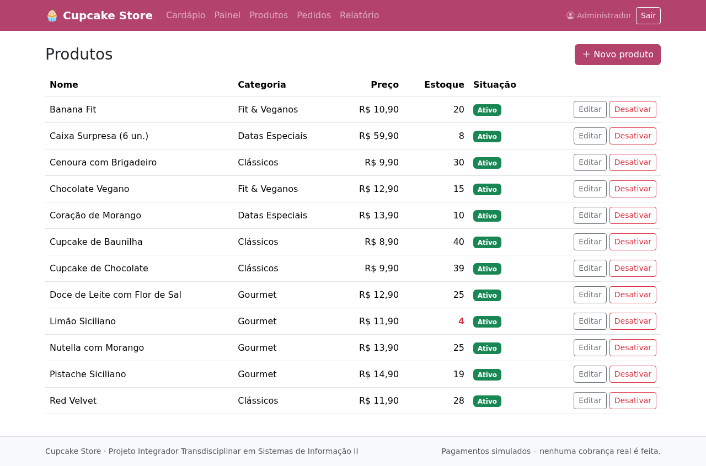

O sistema valida os dados:
- preço maior que zero;
- estoque não negativo;
- URL da imagem terminando em .jpg ou .png.

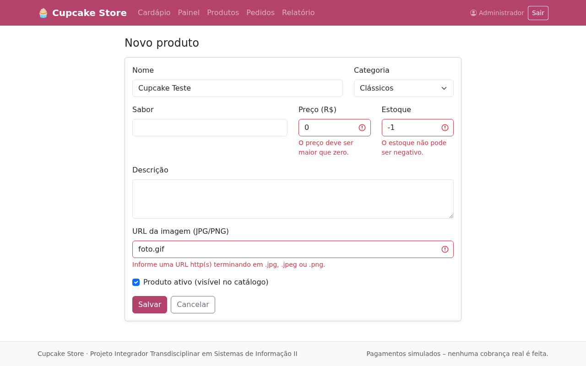

### 3. Gerenciar pedidos e entregas
Em **Pedidos**, filtre por status e clique no número do pedido. Nele, altere o status (Pago → Em preparo → Saiu para entrega → Entregue) e escolha o entregador. O cliente vê a mudança na hora, em "Meus pedidos".
Pedidos aguardando pagamento ou cancelados não podem mudar de status.

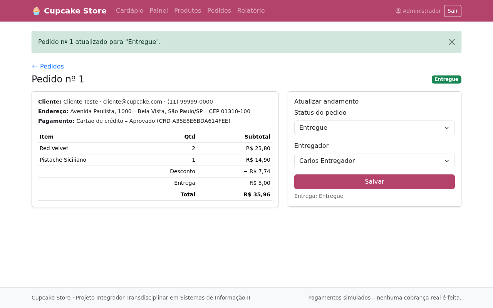

### 4. Relatório de vendas
Escolha o período e clique em **Filtrar**. O relatório mostra:
- a quantidade de pedidos pagos;
- o faturamento;
- o ticket médio;
- o ranking dos cupcakes mais vendidos.

Use **Imprimir** para salvar em PDF.

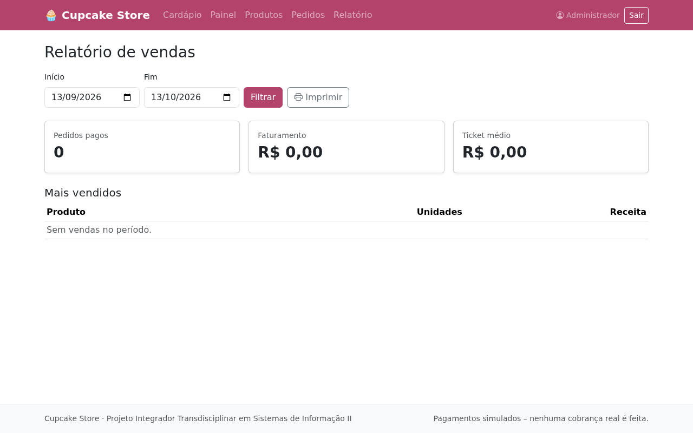
